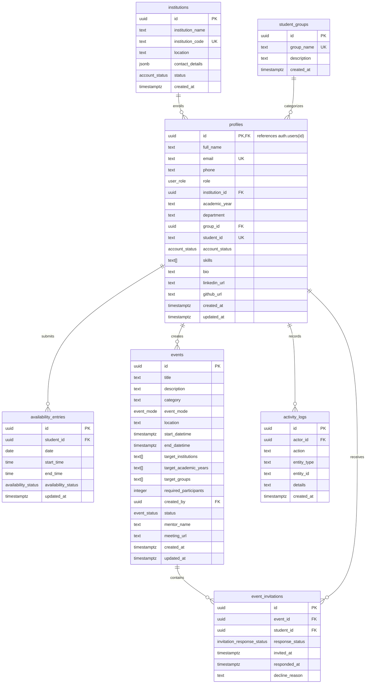

# Maatram Sync: Enterprise Event Coordination & Scholar Portal

Maatram Sync is a modern SaaS event coordination and availability synchronization platform engineered for the **Maatram Foundation**. It bridges students, the central Office Operations team, and System Administrators by allowing scholars to share when they are free, empowering coordinators to analyze multi-institution schedule overlaps and schedule high-impact workshops, while providing administrators with rigorous governance over student registrations, college partnerships, category taxonomies, and audit trails.

---

## 🎨 Strict Brand Design System

Strict adherence to the official Maatram brand palette:

| Color Name | Hex Code | Tailwind Token | Application |
| :--- | :--- | :--- | :--- |
| **Near Black** | `#050505` | `bg-ink`, `text-ink` | Sidebars, primary headers, contrast badges, dark accents |
| **Maatram Gold** | `#F5BE24` | `bg-gold`, `text-gold` | Active nav highlights, primary CTAs, peak overlap states, recommendation badges |
| **White** | `#FFFFFF` | `bg-white`, `text-white` | Content cards, data tables, modals, popovers |
| **Charcoal** | `#292929` | `bg-charcoal`, `text-charcoal` | Subtle borders (`border-charcoal/15`), secondary actions, busy/unavailable time slots |
| **Warm Off-white** | `#F7F7F4` | `bg-offwhite` | Application canvas & page background |

---

## 🚀 Getting Started

### 1. Install Dependencies
```bash
npm install
```

### 2. Configure Environment Variables
Copy `.env.example` to `.env`:
```bash
cp .env.example .env
```
Fill in your Supabase project parameters:
```env
VITE_SUPABASE_URL=https://your-project.supabase.co
VITE_SUPABASE_ANON_KEY=your-anon-public-key
```

### 3. Start Development Server
```bash
npm run dev
```

### 4. Production Build
```bash
npm run build
```

---

## ⚡ Supabase Backend Architecture & Integration

Maatram Sync is powered by **Supabase PostgreSQL**, **Supabase Authentication**, and strict **Row Level Security (RLS)** policies enforced at the database level.

### 1. Database Relational Model

The database schema is organized into 7 relational tables defined in [`supabase/schema.sql`](file:///c:/Users/sivas/Downloads/files/supabase/schema.sql):



---

### 2. Row Level Security (RLS) Policy Matrix

Permissions are enforced at the PostgreSQL database level using `auth.uid()` and the `public.get_user_role()` security definer function:

| Database Table | Student Role | Office Team Role | Administrator Role |
| :--- | :--- | :--- | :--- |
| **`profiles`** | SELECT own (`id = auth.uid()`), UPDATE permitted personal fields only (`bio`, `phone`, `skills`, `links`). Role changes blocked. | SELECT all where `role = 'student'`. Cannot update or delete records. | SELECT all profiles. INSERT/UPDATE student profiles (`role = 'student'`). Status toggles. |
| **`institutions`** | SELECT active institutions. | SELECT active institutions. | Full ALL (INSERT, UPDATE, DELETE). Delete blocked if students exist. |
| **`student_groups`** | SELECT groups. | SELECT groups. | Full ALL (INSERT, UPDATE, DELETE). |
| **`availability_entries`** | SELECT, INSERT, UPDATE, DELETE only own records (`student_id = auth.uid()`). | SELECT all entries for dynamic overlap analysis calculations. | SELECT all entries. |
| **`events`** | SELECT invited events or scheduled workshops. | Full ALL (INSERT, UPDATE, DELETE). | SELECT read-only. (Restricted from planning operational sessions). |
| **`event_invitations`** | SELECT own invitations. UPDATE response status (`Accepted` / `Declined`). | Full ALL (dispatch batch invitations, send reminders). | SELECT read-only. |
| **`activity_logs`** | INSERT own user activities. | SELECT operational logs, INSERT event logs. | Full SELECT across all administrative & operations audit records. |

*Security Notice: The Supabase `service-role` key is **never** bundled or exposed in frontend code. All client requests run with the public `anon` key governed by RLS.*

---

### 3. Step-by-Step Supabase Setup Guide

1. **Create Supabase Project**:
   * Open the [Supabase Dashboard](https://supabase.com/dashboard) and create a new project.
2. **Execute Database Migrations**:
   * Open the **SQL Editor** in your Supabase dashboard.
   * Copy and paste the contents of [`supabase/schema.sql`](file:///c:/Users/sivas/Downloads/files/supabase/schema.sql) and click **Run**.
3. **Execute Seed Data (Optional for Demo)**:
   * In the SQL Editor, copy and run [`supabase/seed.sql`](file:///c:/Users/sivas/Downloads/files/supabase/seed.sql) to populate colleges and initial student cohorts.
4. **Configure Environment Variables**:
   * In your project dashboard, navigate to **Project Settings > API**.
   * Copy the **Project URL** and **anon / public key**.
   * Add them to `.env`:
     ```env
     VITE_SUPABASE_URL=https://xxxxxxxxxxxx.supabase.co
     VITE_SUPABASE_ANON_KEY=eyJhbGciOiJIUzI1NiIsInR5cCI6IkpXVCJ9...
     ```
5. **Start Application**:
   * Run `npm run dev` and sign in! The sign-in panel displays a live indicator:
     `● Connected to live Supabase Authentication`

---

## 🔑 Demo Credentials (Mock Sign-In Fallback)

If no Supabase environment is configured yet, the platform seamlessly runs in mock-assisted developer mode:

| Role | Email | Password | Landing Destination | Primary Responsibilities |
| :--- | :--- | :--- | :--- | :--- |
| **Student** | `student@maatram.dev` | `Student@123` | `/student` | Submit availability, RSVP to invitations, view sessions |
| **Office Team** | `office@maatram.dev` | `Office@123` | `/office` | Overlap analysis, event planning, invitations, sessions |
| **Admin** | `admin@maatram.dev` | `Admin@123` | `/admin` | Student registration, bulk CSV import, institutions, categories, audit logs |

---

## 🛡️ Route Protection Architecture

Routes in [`src/App.tsx`](file:///c:/Users/sivas/Downloads/files/src/App.tsx) are wrapped with `<ProtectedRoute>` and `<AuthProvider>`:
* **Unauthenticated Access**: Attempts to access `/student`, `/office`, or `/admin` without an active session automatically redirect to `/login`.
* **Cross-Role Encroachment**: If a `student` navigates to `/office` or `/admin`, they are automatically redirected to their authorized landing page (`/student`).
* **Session Persistence**: Sessions are preserved across browser refreshes and tab switches using `localStorage` and `supabase.auth.onAuthStateChange`.
* **Inactive Account Safeguard**: Accounts marked `Inactive` by an Administrator are immediately rejected during sign-in and their sessions are invalidated.

---

## 📦 Directory Structure

```
src/
├── types/
│   ├── auth.ts                       # Auth interfaces
│   ├── student.ts                    # Student interfaces
│   ├── office.ts                     # Office Team interfaces
│   ├── admin.ts                      # Admin, Institution, Category, and Activity interfaces
│   └── database.ts                   # Supabase PostgreSQL Database types
├── context/
│   └── AuthContext.tsx               # Supabase Auth Provider, role detection, session listener
├── lib/
│   ├── supabaseClient.ts             # Supabase client instantiation with fallback detection
│   ├── roles.ts                      # ROLE_HOME routing (/student, /office, /admin)
│   ├── validation.ts                 # Input validation
│   └── utils.ts                      # Date & math utilities
├── services/
│   ├── auth/
│   │   ├── index.ts                  # Export active auth service
│   │   ├── supabaseAuthService.ts    # Supabase signIn, signOut, role resolution, status check
│   │   └── mockAuthService.ts        # Dev fallback accounts
│   ├── student/                      # Student service layer connecting to Supabase
│   ├── office/                       # Office analysis algorithm & event management
│   └── admin/                        # Admin student provisioning, institutions & categories
├── components/
│   ├── ui/                           # Reusable UI primitives (Button, Input, Card, Modal, etc.)
│   ├── auth/                         # BrandMark, BrandPanel, LoginForm, ProtectedRoute
│   ├── student/                      # Student dashboard tabs & components
│   ├── office/                       # Office team dashboard components
│   └── admin/                        # Admin dashboard components
├── pages/
│   ├── LoginPage.tsx                 # Unified login page
│   ├── student/StudentDashboardPage.tsx
│   ├── office/OfficeDashboardPage.tsx
│   └── admin/AdminDashboardPage.tsx  # Admin dashboard page route
├── App.tsx                           # Protected router with AuthProvider
└── main.tsx
supabase/
├── schema.sql                        # Complete PostgreSQL DDL, Triggers, and RLS Policies
└── seed.sql                          # Initial institutions and scholar categorization
```
